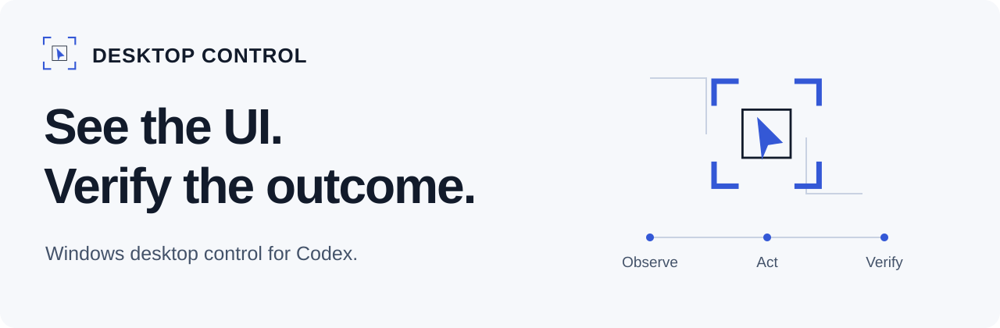

<picture>
  <source media="(prefers-color-scheme: dark)" srcset="assets/brand/hero-dark.svg">
  <source media="(prefers-color-scheme: light)" srcset="assets/brand/hero-light.svg">
  
</picture>

# Desktop Control

**Give Codex a trustworthy view of your Windows application—and a guarded way to act on it.**

A local, headless MCP plugin for inspecting rendered interfaces, following UI instructions, and checking what actually changed. Codex interprets the images; Desktop Control supplies authorized observations, exact targets, and execution receipts.

[Quick start](#quick-start) · [What you can do](#what-you-can-do) · [Safety](#authorization-is-part-of-the-workflow) · [Updates](docs/INSTALLATION.md#updates-and-rollback) · [Release v0.14.0](https://github.com/Zerk0n/Desktop-Control/releases/tag/v0.14.0)

**Windows x64 · Codex · MCP 1.35.0 · 31 tools**

## Quick start

Requires Windows x64 and a Codex build with plugin/marketplace support. From an external terminal, close owning Codex sessions normally, then run:

```powershell
codex plugin marketplace add https://github.com/Zerk0n/Desktop-Control.git --ref v0.14.0
codex plugin add codex-desktop-control@desktop-control-local
```

Reopen Codex. Confirm that **Desktop Control**, its `desktop-control` skill, and the intended tools are available. Review the normal host and local application approvals before acting.

Already registered this marketplace? [Read the existing-installation instructions](docs/INSTALLATION.md) first. Do not remove the plugin, overwrite your configuration, or force-close a locked cache to make an update work.

Try a bounded request on an application you own:

> Inspect this window for clipped text, overlap, spacing, and readability. Show the image evidence. Make no changes yet.

Or, on a disposable UI fixture:

> Save these preferences once, independently check the saved status, then show me a fresh image. Stop if the target changes or execution is uncertain.

## Observe → Act → Verify

1. **Observe** an authorized window or detail region. Inspect the actual image, with UIA or optional local OCR as supporting evidence.
2. **Act** through a supported semantic method, or explicitly authorized physical input, bound to the current target.
3. **Verify** with a separate observation or postcondition. A successful Run ending in `observe` delivers its final image.

A dispatch receipt is not proof of the intended effect. Uncertain actions are never automatically replayed.

## What you can do

| Task | Evidence and boundaries |
| --- | --- |
| Review UI quality | Actual rendered images for clipping, overlap, hierarchy, spacing, and readability. The consuming model makes the judgment. |
| Follow UI instructions | Exact UIA targets, supported native routing, and guarded physical input with independent authorization. |
| Inspect dense interfaces | Scoped UIA drill-down and bounded search with explicit completeness. Incomplete enrichment can retain the authorized image without creating a baseline. |
| Check an outcome | Fresh observations and typed postconditions; ordered Run receipts retain uncertainty. |
| Use supporting visual evidence | Optional bounded local Windows OCR and visual candidates. Neither proves actionability or visual quality. |

## Authorization is part of the workflow

Read/View, Write/Edit, System/Global Input, and Desktop/All Screens are separate permissions. New policy defaults to **ASK**; applicable DENY remains effective. A read, target reference, or earlier approval grants no authority for a later action.

Exact window/session identity, fresh-frame checks, human priority, private control, and Emergency Stop remain enforced. Application ALLOW does not grant shell authority. The MCP runtime is local-only, with no outbound runtime dependency; your Codex consumer's data handling is separate.

[Permission guide](plugins/codex-desktop-control/skills/desktop-control/references/permissions.md) · [Security and reporting](SECURITY.md)

## Know the limits

The exact 0.14.0 package passed scoped installed-Codex **WPF and WinForms** image delivery, action/postcondition, dense observation, stale-reference, and private-control checks. Separate installed-binary checks covered Stop and explicit DENY. This is scoped evidence, not universal Windows compatibility.

Browser/API same-target integration and some Windows shell surfaces remain unavailable. Virtualized content and separate popups require explicit discovery. PiP, Child Sessions, and COM bootstrap are retired. OUT-130 remains open.

Git-marketplace refresh hit Codex's 30-second clone deadline for this payload on the tested host. Keep the last validated snapshot; [use a validated local checkout when needed](docs/INSTALLATION.md#when-git-marketplace-refresh-times-out). Refresh alone never replaces a running MCP process.

## Documentation

- [Installation, updates, and rollback](docs/INSTALLATION.md)
- [31-tool MCP contract](plugins/codex-desktop-control/contracts/mcp-tools.v1.json)
- [Consumer skill and workflows](plugins/codex-desktop-control/skills/desktop-control/SKILL.md)
- [Verification scope and package integrity](docs/VERIFICATION.md)
- [Contributing and support](CONTRIBUTING.md)

This repository distributes the packaged plugin; it is not the development source tree. No project license has been declared. Do not infer an open-source license or redistribution rights from public availability; see [contribution guidance](CONTRIBUTING.md#license-status).
